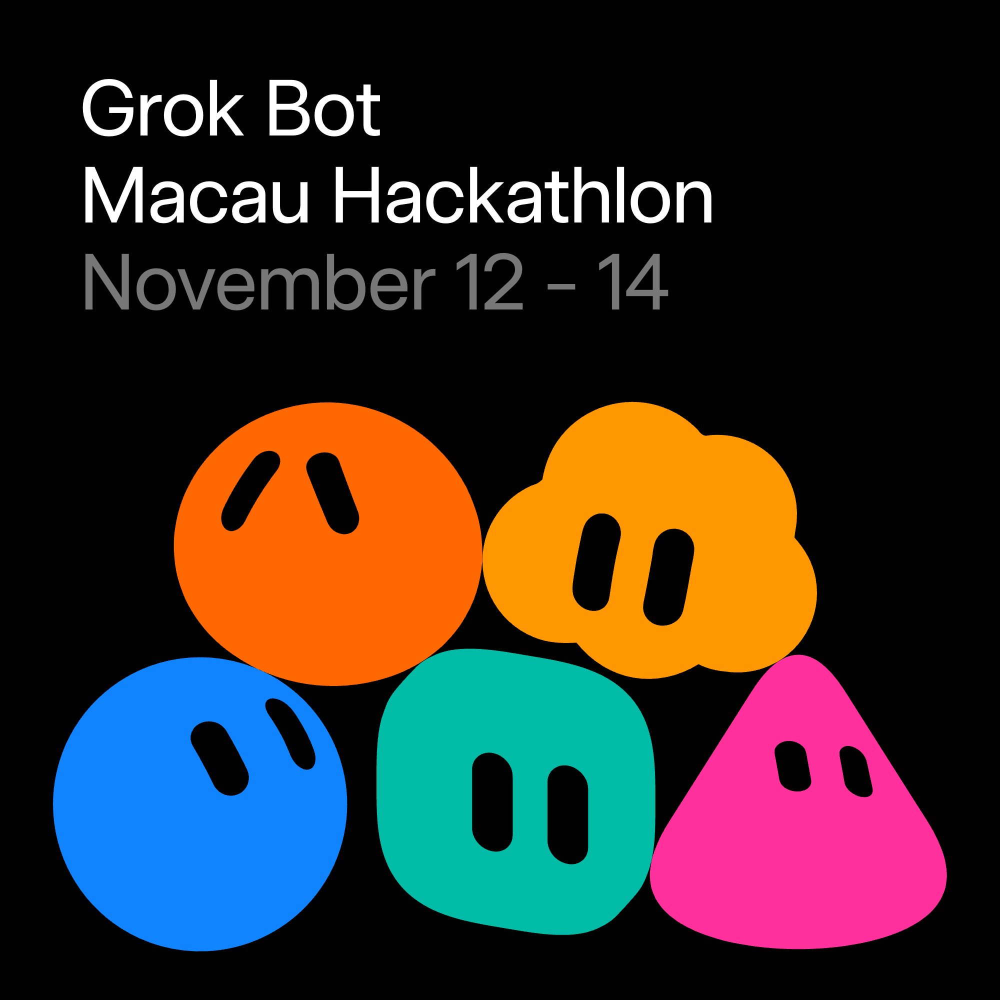
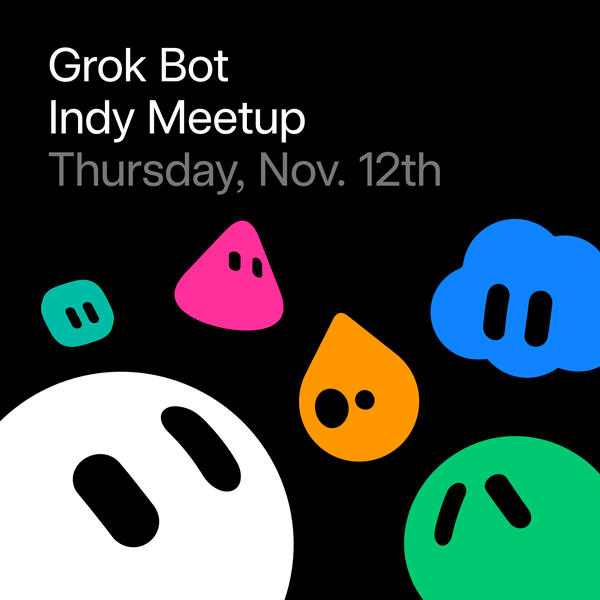
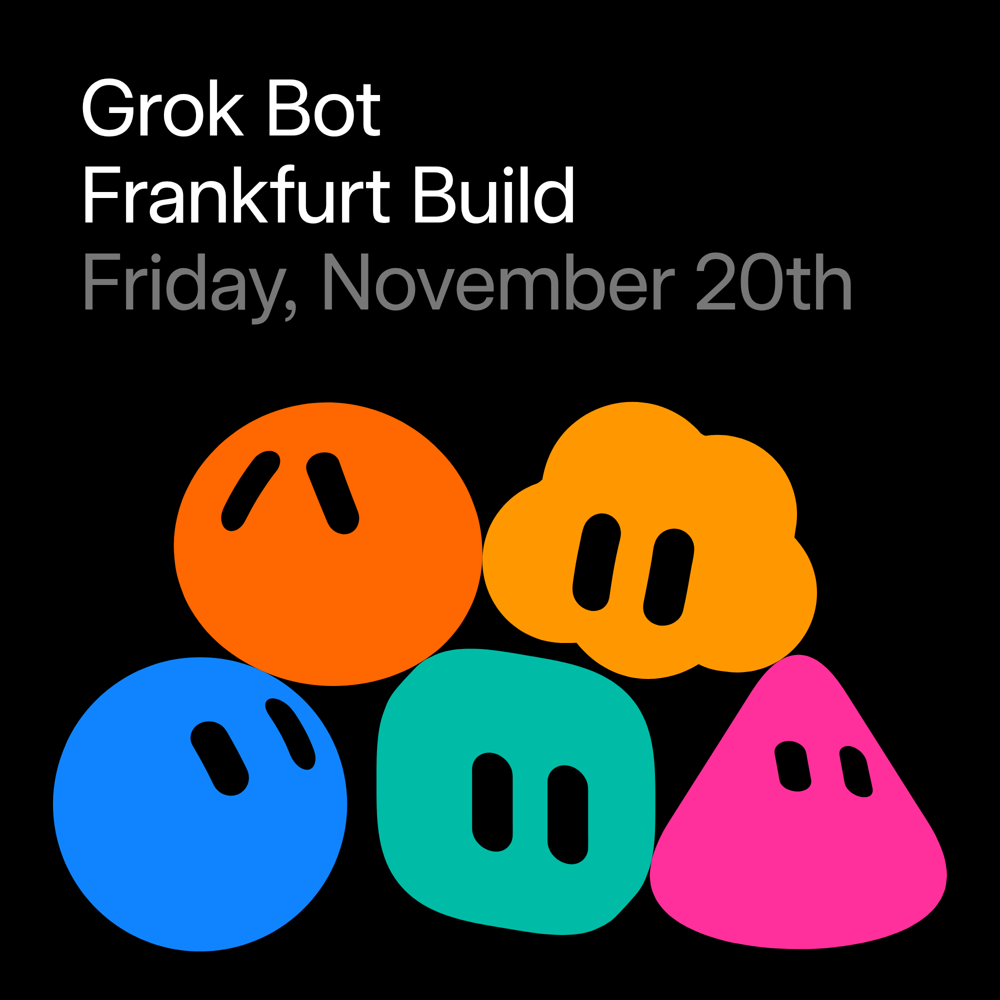
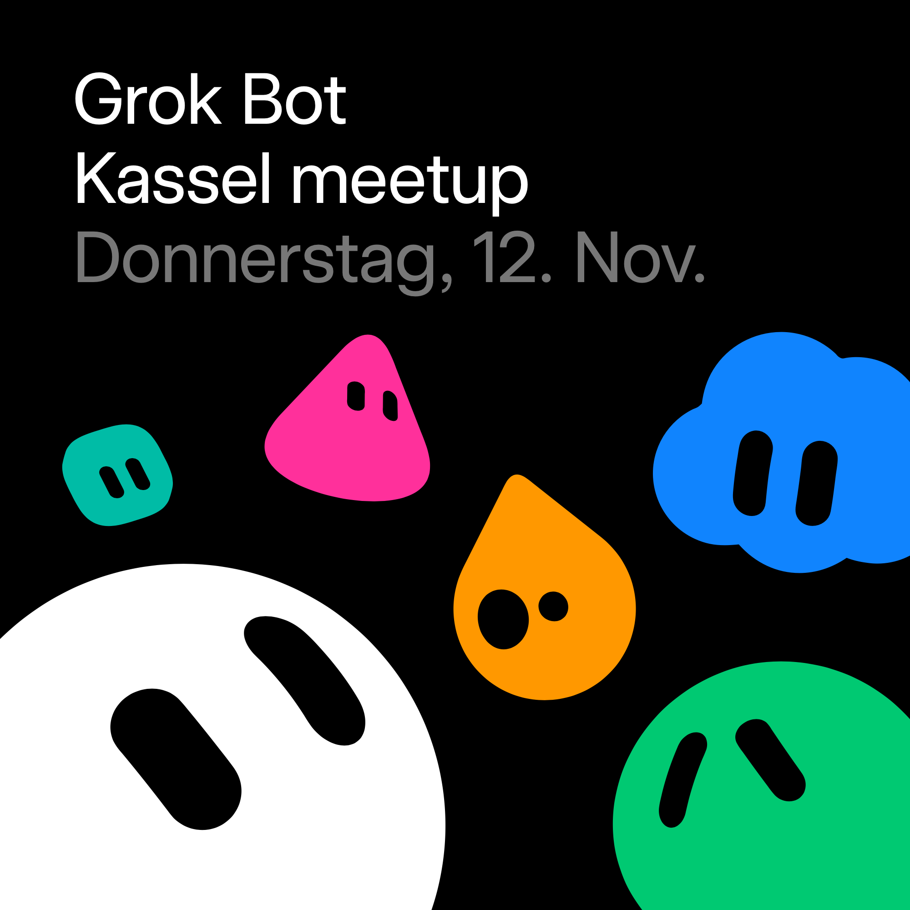
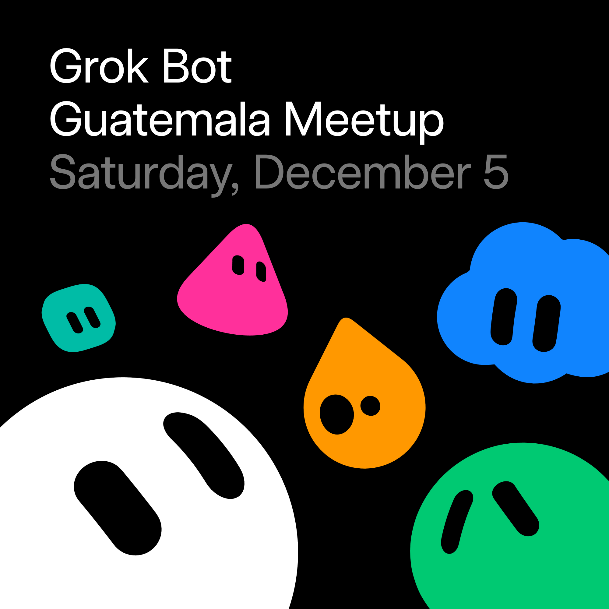
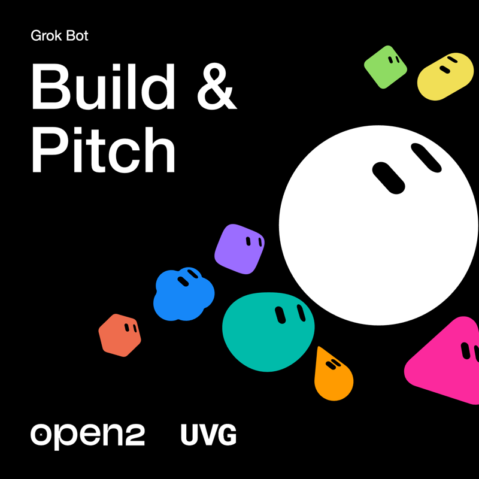
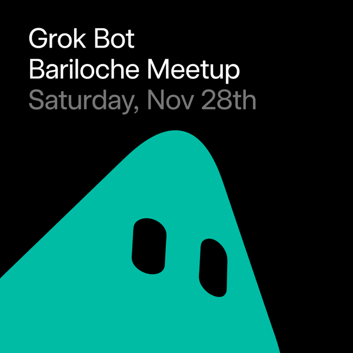
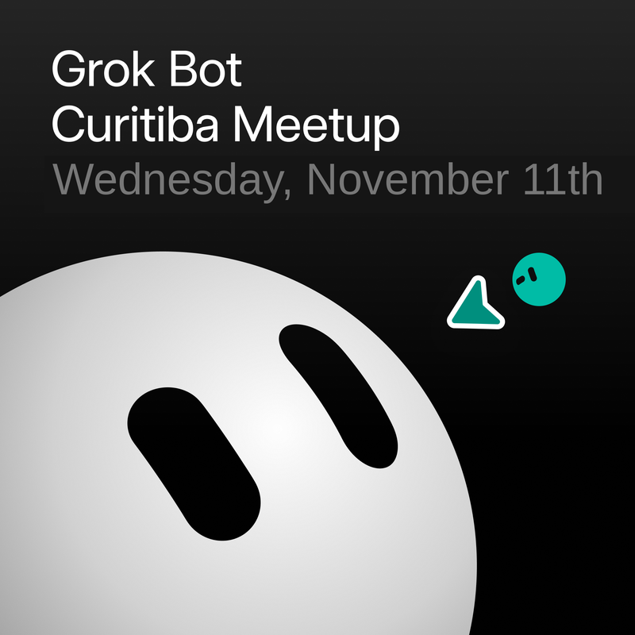
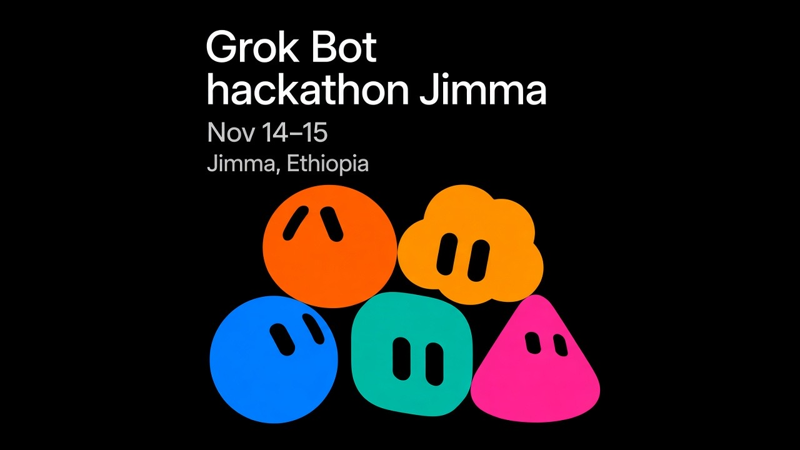

# イベント

<a href="./EVENTS.md"><strong>EN</strong></a> · <a href="./EVENTS.zh.md"><strong>中文</strong></a> · <strong>日本語</strong>

ポスター、会場、申し込み。README は国ごとに都市を並べ、名前を押すとこのページの該当イベントへ飛びます。

[一覧に戻る](./README.ja.md)

### 中国

<table><tr><td width="320" valign="top"></td><td valign="top"><strong>SpaceXAI マカオ Community Hackathon｜Grok Bot × Physical AI</strong> 2026-11-12（木）– 11-14（土）、毎日 10:00–18:00（Asia/Macau、UTC+8） マカオ · マカオ・タワー · オフライン  マカオ 3 日間ハッカソン。2 トラック：Grok Bot で 3 日で会社を作る／Physical AI × Grok Bot（公開＋高校生）（主催 John Ku、フォーラム 173330 / Luma spacexai-macau-hackathlon-nov）。ノート PC 持参。個人登録・現地でチーム編成。承認制。朝スキャン時残り約 80 席。  <a href="https://luma.com/spacexai-macau-hackathlon-nov"><strong>Luma で申し込む →</strong></a></td></tr></table>

### アメリカ

<table><tr><td width="320" valign="top"></td><td valign="top"><strong>Cursor Meetup フィラデルフィア — 11月</strong> 2026-11-17（火）18:00–20:30（America/New_York） フィラデルフィア · SpaceXAI Philadelphia — オフライン  SpaceXAI Community のフィラデルフィア 11 月 Cursor/Grok ミートアップ。Luma で登録。  <a href="https://luma.com/cursor-acqy"><strong>Luma で申し込む →</strong></a></td></tr></table>

<table><tr><td width="320" valign="top"></td><td valign="top"><strong>Cursor Meetup フィラデルフィア — 12月</strong> 2026-12-17（木）18:00–20:30（America/New_York） フィラデルフィア · SpaceXAI Philadelphia — オフライン  SpaceXAI Community のフィラデルフィア 12 月 Cursor/Grok ミートアップ。Luma で登録。  <a href="https://luma.com/cursor-8wr8"><strong>Luma で申し込む →</strong></a></td></tr></table>

<table><tr><td width="320" valign="top"></td><td valign="top"><strong>Grok Bot タンパベイ Meetup</strong> 2026-11-14（土）13:00–16:00（America/New_York） フロリダ州タンパベイ · 会場 TBD（登録後に案内）。オフライン。  タンパベイのオフライン Grok Bot ミートアップ（SpaceXAI Tampa）。Luma で登録。  <a href="https://luma.com/spacexai-g0x6"><strong>Luma で申し込む →</strong></a></td></tr></table>

<table><tr><td width="320" valign="top"></td><td valign="top"><strong>Grok Bot Meetup インディアナポリス</strong> 2026-11-12（木）18:00–20:00（America/Indiana/Indianapolis、EST、UTC−5） インディアナ州フィッシャーズ（インディアナポリス近郊）· Launch Fishers（12175 Visionary Way）— オフライン  インディアナポリスのビルダーと事業者向け初の Grok Bot ミートアップ。紹介、ライブデモ、Q&A の後、ビルドタイム（ノート PC とアイデア持参）と参加者デモ。動く Bot を持ち帰るのが目標。経験不要。無料。主催 Jacob Thifault。forum 173949。slug cudopyt3。  <a href="https://luma.com/cudopyt3"><strong>Luma で申し込む →</strong></a></td></tr></table>

<table><tr><td width="320" valign="top"></td><td valign="top"><strong>Grok Bot Meetup チャタヌーガ</strong> 2026-12-16（水）18:00–20:00（America/New_York、EST、UTC−5） テネシー州チャタヌーガ · The Enterprise Center（1010 Georgia Ave）— オフライン  SpaceXAI for Chattanooga カレンダーの Grok Bot ミートアップ。ホスト Will Rowston。Luma ページにはまだアジェンダなし。無料登録。  <a href="https://luma.com/xoi05vfx"><strong>Luma で申し込む →</strong></a></td></tr></table>

### ドイツ

<table><tr><td width="320" valign="top"></td><td valign="top"><strong>Build with Grokbot — フランクフルト（11/20）</strong> 2026-11-20（金）14:00–22:30（Europe/Berlin、UTC+1）。 ドイツ・フランクフルト — Hotel Motel One Frankfurt-Messe（オフライン）。  フランクフルトの Build with Grokbot（9/10月に続く回；SpaceXAI for Frankfurt；ホスト DJ Gangan ほか）。Motel One Messe で午後〜夜のビルド。ウェイトリストあり（スキャン時 guest_count 3）。slug l9tfh081。  <a href="https://luma.com/l9tfh081"><strong>Luma で申し込む →</strong></a></td></tr></table>

<table><tr><td width="320" valign="top"></td><td valign="top"><strong>Grok Bot Meetup カッセル</strong> 2026-11-12（木）18:00–22:00（Europe/Berlin、CET、UTC+1） ドイツ・カッセル · 登録後に会場表示（Bettenhausen 付近）· オフライン  カッセル初の Grok Bot ミートアップ（SpaceXAI for Kassel、主催 Eyad Kelleh / Maurice Pfurr ほか、フォーラム 173331 / Luma rx61bqy9）。交流・デモ・現地クレジット試用。承認＋ウェイトリスト。朝スキャン時 guest_count 2。  <a href="https://luma.com/rx61bqy9"><strong>Luma で申し込む →</strong></a></td></tr></table>

### グアテマラ

<table><tr><td width="320" valign="top"></td><td valign="top"><strong>Grok Bot Meetup グアテマラ</strong> 2026-12-05（土）15:00–20:00（America/Guatemala） グアテマラ · 会場 TBD（Luma / 主催更新を参照）— オフライン  SpaceXAI グアテマラのオフライン Grok Bot ミートアップ（フォーラム+Luma）。会場は Luma で確認。  <a href="https://luma.com/spacexai-97mt"><strong>Luma で申し込む →</strong></a></td></tr></table>

<table><tr><td width="320" valign="top"></td><td valign="top"><strong>Grok Bot Guatemala: Build & Pitch（グアテマラ）</strong> 2026-11-21（土）08:00–15:00（America/Guatemala、CST、UTC−6） グアテマラシティ · Universidad del Valle de Guatemala（詳細住所は登録後）— オフライン  スペイン語のビルド＆ピッチ。Grok Bot で 4 時間続けて個人またはチームで開発し、短いピッチと直接のフィードバック。無料 RSVP。forum 173855。slug c398wllp。  <a href="https://luma.com/c398wllp"><strong>Luma で申し込む →</strong></a></td></tr></table>

### アルゼンチン

<table><tr><td width="320" valign="top"></td><td valign="top"><strong>Grok Bot Meetup バリローチェ · コミュニティ 1 周年</strong> 2026-11-28（土）19:00–22:00（アルゼンチン時間、ART、UTC−3） サン・カルロス・デ・バリローチェ · Av. Ezequiel Bustillo 3170 — オフライン  SpaceXAI Bariloche の 1 周年 Show & Tell。誰でも数分で AI のプロジェクトやアイデア、実験を見せられ、見るだけでも OK。AI の知識不要。主催 Alonso Arias。無料。  <a href="https://luma.com/spacexai-ztlq"><strong>Luma で申し込む →</strong></a></td></tr></table>

### ブラジル

<table><tr><td width="320" valign="top"></td><td valign="top"><strong>Grok Bot Curitiba Startups Meetup</strong> 2026-11-11（水）18:30–21:00（BRT） クリチバ Rua Marcos Moro 72  クリチバのスタートアップ向け。Grok Bot での作り方、創業者の知見、エージェント時代の出荷（登壇者は未定）。主催者承認が必要。  <a href="https://luma.com/cursor-dx23"><strong>Luma で申し込む（主催者承認） →</strong></a></td></tr></table>

### エチオピア

<table><tr><td width="320" valign="top"></td><td valign="top"><strong>Grok Bot Hackathon ジンマ</strong> 2026-11-14（土）08:00〜11-15（日）11:00（Africa/Addis_Ababa、EAT、UTC+3） エチオピア・ジンマ · ジンマ大学 — オフライン  SpaceXAI アディスアベバのカレンダーによる、ジンマ大学での泊まり込み Grok Bot ハッカソン。主催 natnael Eskinder、Alpha Lencho。無料 RSVP。forum 173854。slug spacexai-yijh。  <a href="https://luma.com/spacexai-yijh"><strong>Luma で申し込む →</strong></a></td></tr></table>

### トーゴ

<table><tr><td width="320" valign="top"></td><td valign="top"><strong>Grok Bot Build Day Lomé（ロメ）</strong> 2026-11-14（土）09:00–17:00（Africa/Lome、GMT、UTC+0） トーゴ・ロメ · Lomé Business School（LBS）、96 Jean-Paul 2 — オフライン  フランス語の 1 日ハッカソン。Grok Bot 紹介、チーム結成、bot やツールづくり、審査員へのデモ、交流。経験不要。無料 RSVP。forum 173853。slug syepftk0。  <a href="https://luma.com/syepftk0"><strong>Luma で申し込む →</strong></a></td></tr></table>
