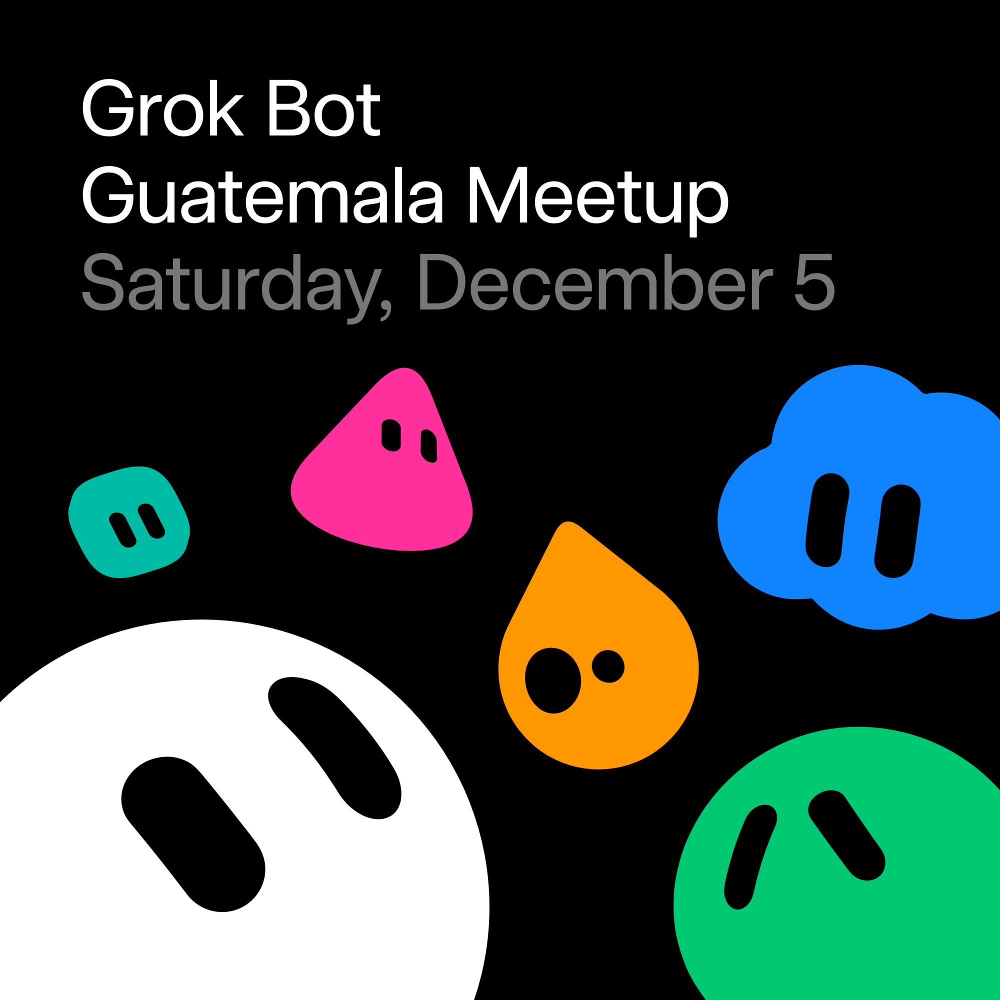
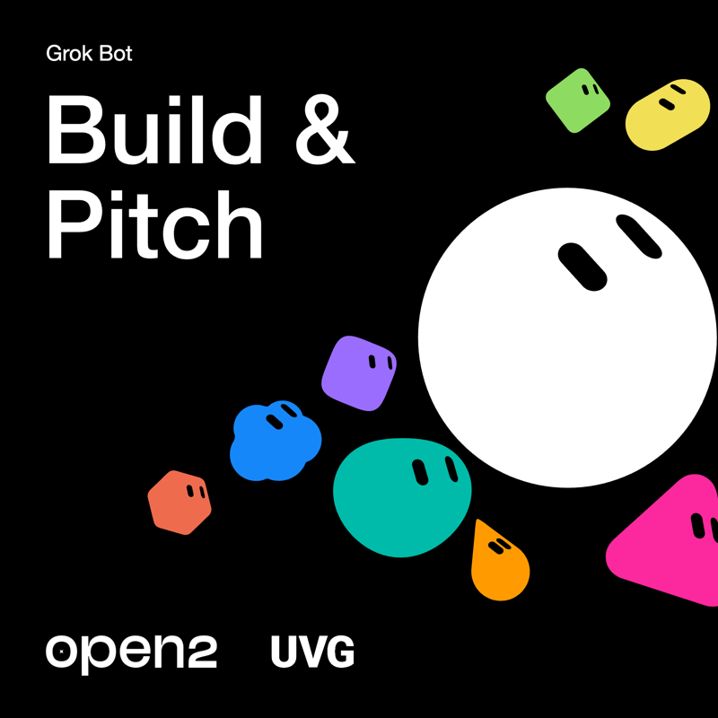
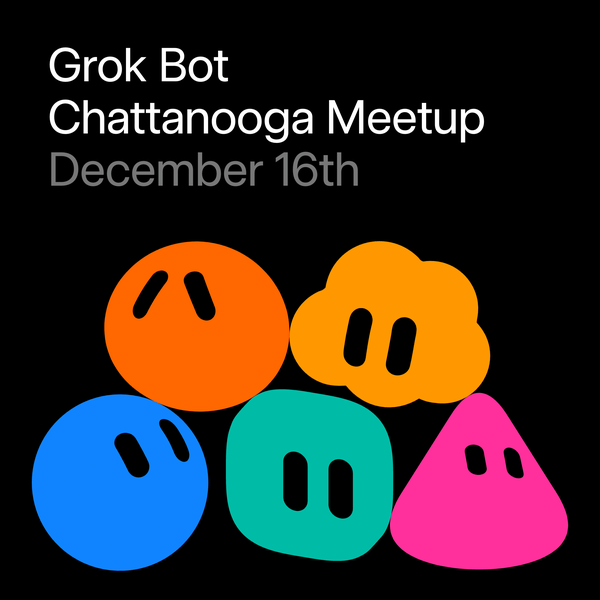
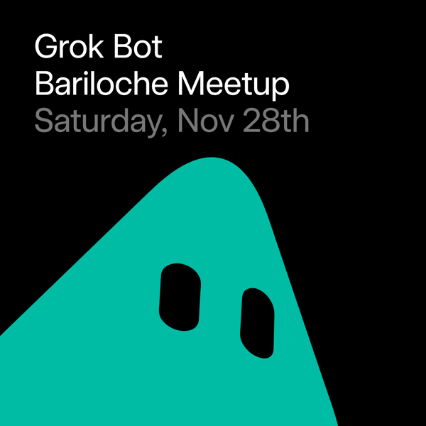
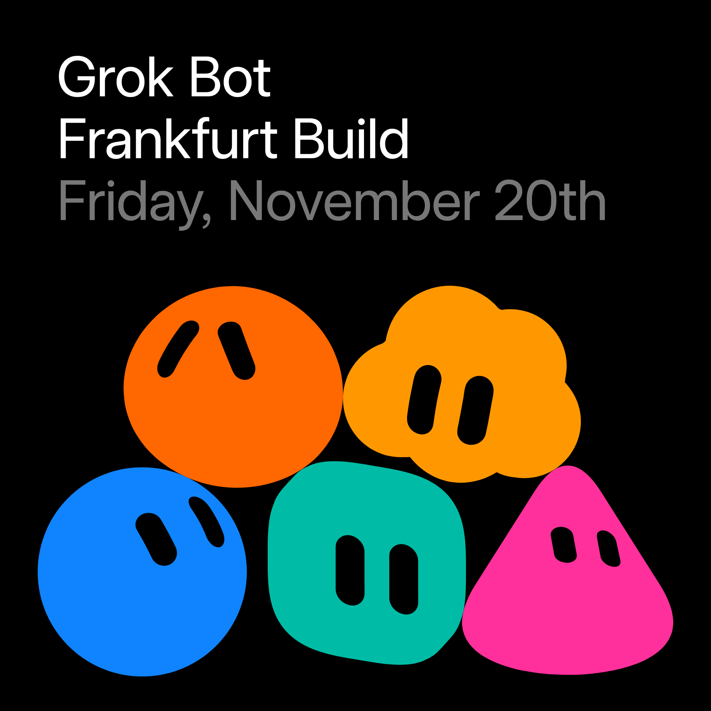

# イベント

<a href="./EVENTS.md"><strong>EN</strong></a> · <a href="./EVENTS.zh.md"><strong>中文</strong></a> · <strong>日本語</strong>

ポスター、会場、申し込み。README は国ごとに都市を並べ、名前を押すとこのページの該当イベントへ飛びます。

[一覧に戻る](./README.ja.md)

### グアテマラ

<table><tr><td width="320" valign="top"></td><td valign="top"><strong>Grok Bot Meetup グアテマラ</strong> 2026-12-05（土）15:00–20:00（America/Guatemala） グアテマラ · 会場 TBD（Luma / 主催更新を参照）— オフライン  SpaceXAI グアテマラのオフライン Grok Bot ミートアップ（フォーラム+Luma）。会場は Luma で確認。  <a href="https://luma.com/spacexai-97mt"><strong>Luma で申し込む →</strong></a></td></tr></table>

<table><tr><td width="320" valign="top"></td><td valign="top"><strong>Grok Bot Guatemala: Build & Pitch（グアテマラ）</strong> 2026-11-21（土）08:00–15:00（America/Guatemala、CST、UTC−6） グアテマラシティ · Universidad del Valle de Guatemala（詳細住所は登録後）— オフライン  スペイン語のビルド＆ピッチ。Grok Bot で 4 時間続けて個人またはチームで開発し、短いピッチと直接のフィードバック。無料 RSVP。forum 173855。slug c398wllp。  <a href="https://luma.com/c398wllp"><strong>Luma で申し込む →</strong></a></td></tr></table>

### アメリカ

<table><tr><td width="320" valign="top"></td><td valign="top"><strong>Cursor Meetup フィラデルフィア — 12月</strong> 2026-12-17（木）18:00–20:30（America/New_York） フィラデルフィア · SpaceXAI Philadelphia — オフライン  SpaceXAI Community のフィラデルフィア 12 月 Cursor/Grok ミートアップ。Luma で登録。  <a href="https://luma.com/cursor-8wr8"><strong>Luma で申し込む →</strong></a></td></tr></table>

<table><tr><td width="320" valign="top"></td><td valign="top"><strong>Grok Bot Meetup チャタヌーガ</strong> 2026-12-16（水）18:00–20:00（America/New_York、EST、UTC−5） テネシー州チャタヌーガ · The Enterprise Center（1010 Georgia Ave）— オフライン  SpaceXAI for Chattanooga カレンダーの Grok Bot ミートアップ。ホスト Will Rowston。Luma ページにはまだアジェンダなし。無料登録。  <a href="https://luma.com/xoi05vfx"><strong>Luma で申し込む →</strong></a></td></tr></table>

### アルゼンチン

<table><tr><td width="320" valign="top"></td><td valign="top"><strong>Grok Bot Meetup バリローチェ · コミュニティ 1 周年</strong> 2026-11-28（土）19:00–22:00（アルゼンチン時間、ART、UTC−3） サン・カルロス・デ・バリローチェ · Av. Ezequiel Bustillo 3170 — オフライン  SpaceXAI Bariloche の 1 周年 Show & Tell。誰でも数分で AI のプロジェクトやアイデア、実験を見せられ、見るだけでも OK。AI の知識不要。主催 Alonso Arias。無料。  <a href="https://luma.com/spacexai-ztlq"><strong>Luma で申し込む →</strong></a></td></tr></table>

### ドイツ

<table><tr><td width="320" valign="top"></td><td valign="top"><strong>Build with Grokbot — フランクフルト（11/20）</strong> 2026-11-20（金）14:00–22:30（Europe/Berlin、UTC+1）。 ドイツ・フランクフルト — Hotel Motel One Frankfurt-Messe（オフライン）。  フランクフルトの Build with Grokbot（9/10月に続く回；SpaceXAI for Frankfurt；ホスト DJ Gangan ほか）。Motel One Messe で午後〜夜のビルド。ウェイトリストあり（スキャン時 guest_count 3）。slug l9tfh081。  <a href="https://luma.com/l9tfh081"><strong>Luma で申し込む →</strong></a></td></tr></table>
