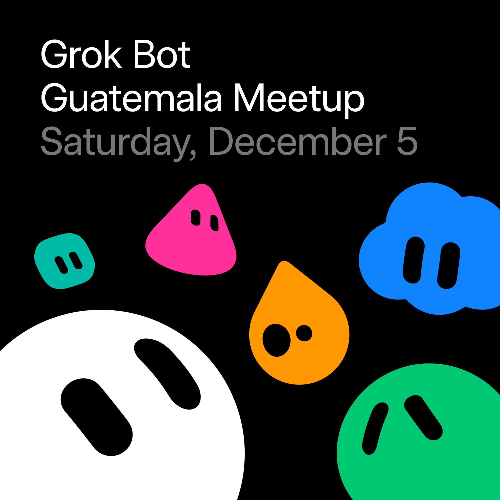
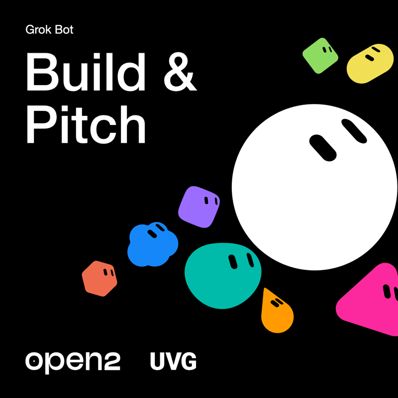
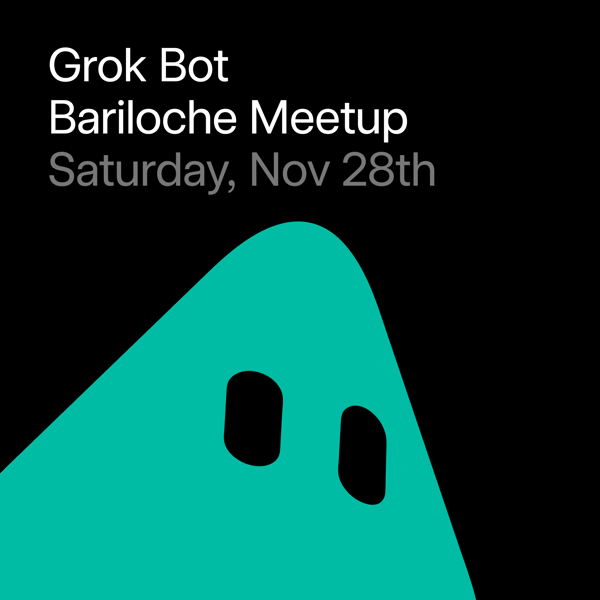
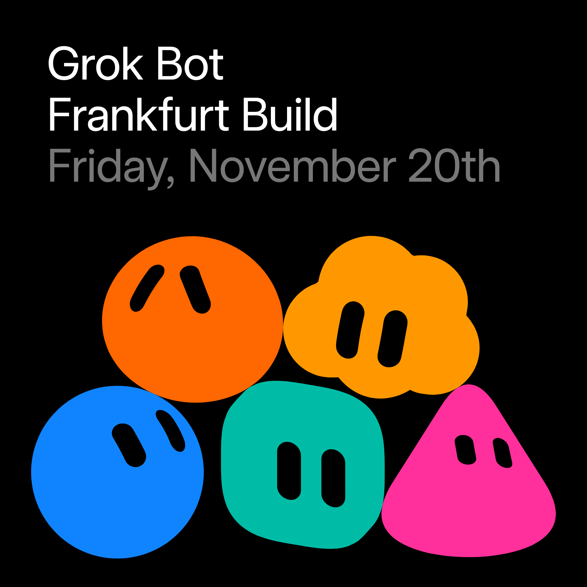

# Upcoming

<strong>EN</strong> · <a href="./EVENTS.zh.md"><strong>中文</strong></a> · <a href="./EVENTS.ja.md"><strong>日本語</strong></a>

Posters, venues, and how to register. The README groups cities by country; tap a name to jump here.

[Back to the list](./README.md)

### Guatemala

<table><tr><td width="320" valign="top"></td><td valign="top"><strong>Grok Bot Meetup Guatemala</strong> Sat 5 Dec 2026, 15:00–20:00 (America/Guatemala) Guatemala · venue TBA (see Luma / host update) — offline  SpaceXAI Guatemala offline Grok Bot meetup (forum + Luma). Register on Luma for venue details.  <a href="https://luma.com/spacexai-97mt"><strong>Register on Luma →</strong></a></td></tr></table>

<table><tr><td width="320" valign="top"></td><td valign="top"><strong>Grok Bot Guatemala: Build & Pitch</strong> Sat 21 Nov 2026, 08:00–15:00 (America/Guatemala, CST, UTC−6) Guatemala City · Universidad del Valle de Guatemala (exact address after RSVP) — offline  Spanish-language build-and-pitch morning: four straight hours building with Grok Bot solo or in a team, then a short pitch and direct feedback. Free RSVP; forum 173855; slug c398wllp.  <a href="https://luma.com/c398wllp"><strong>Register on Luma →</strong></a></td></tr></table>

### United States

<table><tr><td width="320" valign="top"></td><td valign="top"><strong>Cursor Meetup Philadelphia — December</strong> Thu 17 Dec 2026, 18:00–20:30 (America/New_York) Philadelphia · SpaceXAI for Philadelphia — offline  December SpaceXAI Community Cursor/Grok meetup in Philadelphia. Register on Luma.  <a href="https://luma.com/cursor-8wr8"><strong>Register on Luma →</strong></a></td></tr></table>

<table><tr><td width="320" valign="top"></td><td valign="top"><strong>Grok Bot Meetup Chattanooga</strong> Wed 16 Dec 2026, 18:00–20:00 (America/New_York, EST, UTC−5) Chattanooga, TN · The Enterprise Center, 1010 Georgia Ave — offline  Grok Bot meetup on the SpaceXAI for Chattanooga calendar, hosted by Will Rowston; the Luma page has no agenda yet. Free registration.  <a href="https://luma.com/xoi05vfx"><strong>Register on Luma →</strong></a></td></tr></table>

### Argentina

<table><tr><td width="320" valign="top"></td><td valign="top"><strong>Grok Bot Meetup Bariloche · community's first anniversary</strong> Sat 28 Nov 2026, 19:00–22:00 (America/Argentina, ART, UTC−3) San Carlos de Bariloche · Av. Ezequiel Bustillo 3170 — offline  SpaceXAI Bariloche celebrates its first year with a Show & Tell where anyone can show an AI project, idea or experiment for a few minutes, or just watch; no AI background needed. Host Alonso Arias. Free.  <a href="https://luma.com/spacexai-ztlq"><strong>Register on Luma →</strong></a></td></tr></table>

### Germany

<table><tr><td width="320" valign="top"></td><td valign="top"><strong>Build with Grokbot — Frankfurt (20 Nov)</strong> Fri 20 Nov 2026, 14:00–22:30 (Europe/Berlin, UTC+1). Frankfurt am Main, Germany — Hotel Motel One Frankfurt-Messe (offline).  Next Frankfurt Build with Grokbot after the Sep/Oct nights (SpaceXAI for Frankfurt; hosts DJ Gangan, Felix Schiessl, Eyad Kelleh, Sabri Guenes). Afternoon-to-evening build at Motel One Messe; waitlist active (guest_count 3 at scan). Slug l9tfh081 (evt-uVvS2YIX7wA1ATB).  <a href="https://luma.com/l9tfh081"><strong>Register on Luma →</strong></a></td></tr></table>
