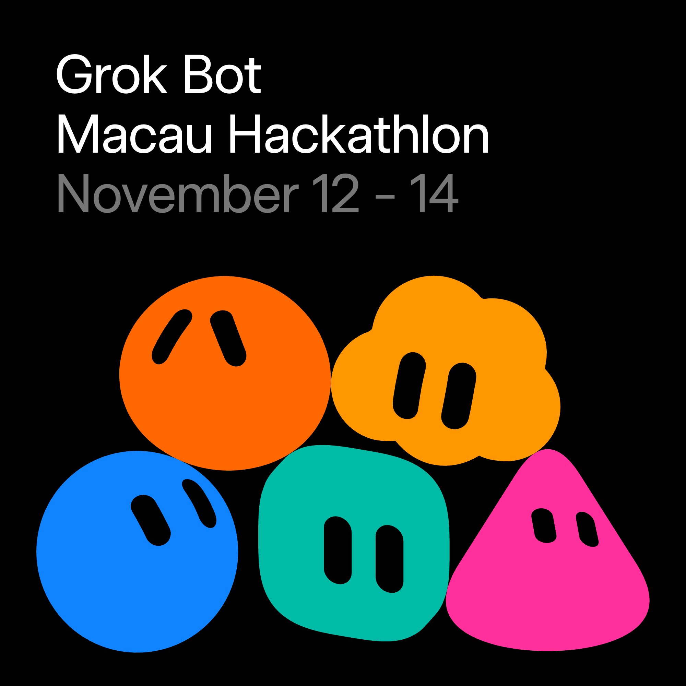
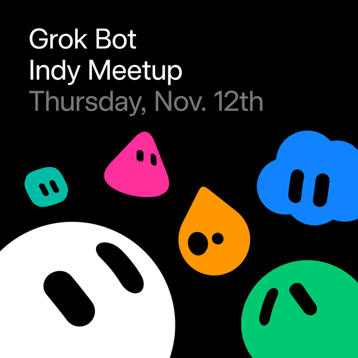
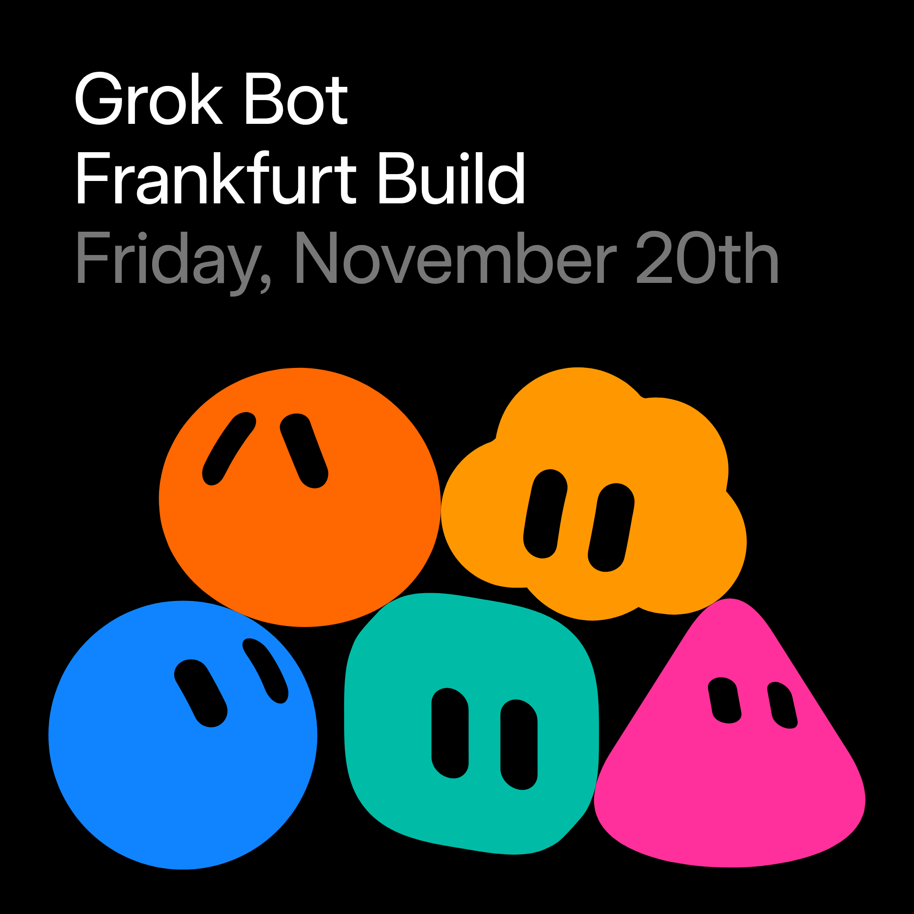
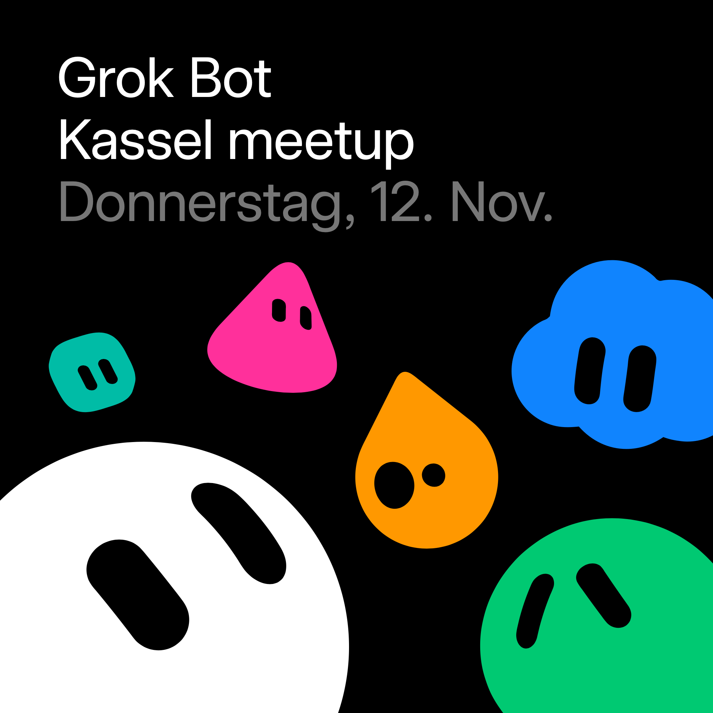
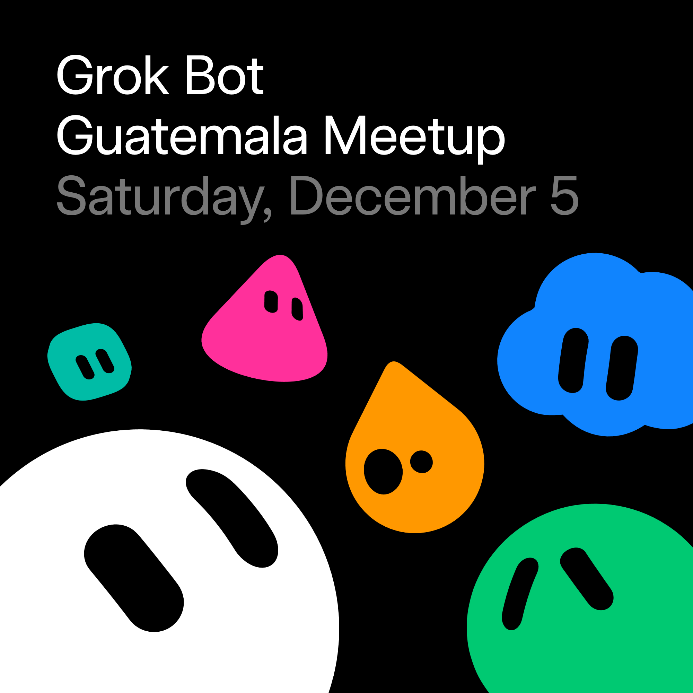
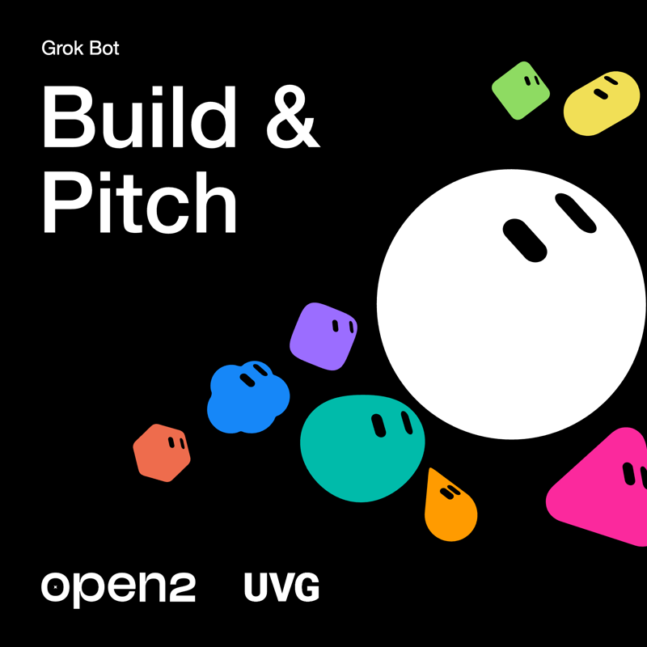
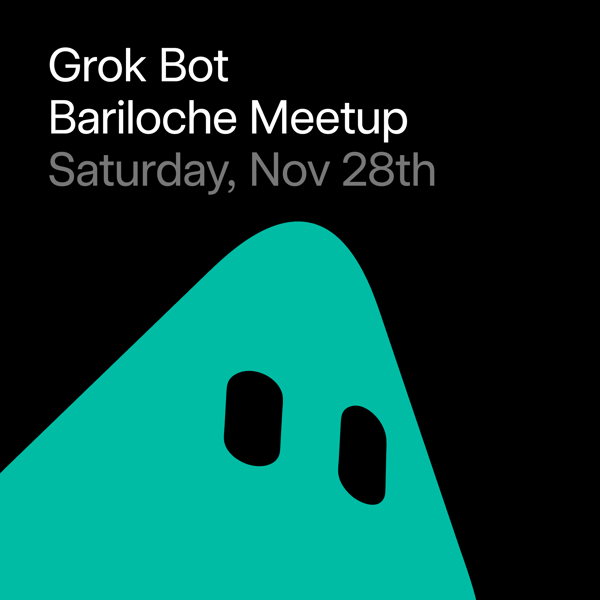
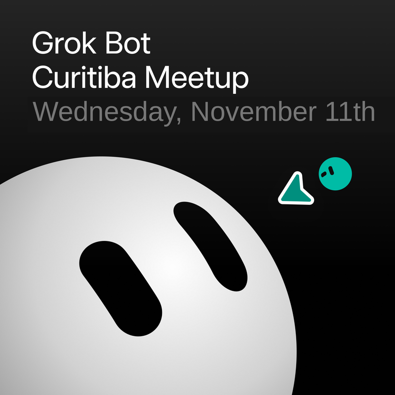

# Upcoming

<strong>EN</strong> · <a href="./EVENTS.zh.md"><strong>中文</strong></a> · <a href="./EVENTS.ja.md"><strong>日本語</strong></a>

Posters, venues, and how to register. The README groups cities by country; tap a name to jump here.

[Back to the list](./README.md)

### China

<table><tr><td width="320" valign="top"></td><td valign="top"><strong>SpaceXAI Macao Community Hackathon｜Grok Bot × Physical AI</strong> Thu 12 – Sat 14 Nov 2026, daily 10:00–18:00 (Asia/Macau, UTC+8) Macau Tower, Macao · offline  Three-day Macao hackathon with two tracks: build a company with Grok Bot, or Physical AI × Grok Bot (open + high-school) (host John Ku; forum 173330 / Luma spacexai-macau-hackathlon-nov). BYO laptop; individual signup, team on site; approval required; spots_remaining 80 at morning scan.  <a href="https://luma.com/spacexai-macau-hackathlon-nov"><strong>Register on Luma →</strong></a></td></tr></table>

### United States

<table><tr><td width="320" valign="top"></td><td valign="top"><strong>Cursor Meetup Philadelphia — November</strong> Tue 17 Nov 2026, 18:00–20:30 (America/New_York) Philadelphia · SpaceXAI for Philadelphia — offline  November SpaceXAI Community Cursor/Grok meetup in Philadelphia. Register on Luma.  <a href="https://luma.com/cursor-acqy"><strong>Register on Luma →</strong></a></td></tr></table>

<table><tr><td width="320" valign="top"></td><td valign="top"><strong>Cursor Meetup Philadelphia — December</strong> Thu 17 Dec 2026, 18:00–20:30 (America/New_York) Philadelphia · SpaceXAI for Philadelphia — offline  December SpaceXAI Community Cursor/Grok meetup in Philadelphia. Register on Luma.  <a href="https://luma.com/cursor-8wr8"><strong>Register on Luma →</strong></a></td></tr></table>

<table><tr><td width="320" valign="top"></td><td valign="top"><strong>Grok Bot Meetup Tampa Bay</strong> Sat 14 Nov 2026, 13:00–16:00 (America/New_York) Tampa Bay, FL · venue TBA (address after register). Offline.  Offline Grok Bot meetup in Tampa Bay hosted with SpaceXAI Tampa. Register on Luma.  <a href="https://luma.com/spacexai-g0x6"><strong>Register on Luma →</strong></a></td></tr></table>

<table><tr><td width="320" valign="top"></td><td valign="top"><strong>Grok Bot Meetup Indianapolis</strong> Thu 12 Nov 2026, 18:00–20:00 (America/Indiana/Indianapolis, EST, UTC−5) Fishers, IN (Indianapolis area) · Launch Fishers, 12175 Visionary Way — offline  First Grok Bot meetup for Indy builders and business owners: intro, live demos, Q&A, then build time (bring a laptop and an idea) and attendee demos, aiming to leave with a working Bot. No experience needed. Free; host Jacob Thifault; forum 173949; slug cudopyt3.  <a href="https://luma.com/cudopyt3"><strong>Register on Luma →</strong></a></td></tr></table>

<table><tr><td width="320" valign="top"></td><td valign="top"><strong>Grok Bot Meetup Chattanooga</strong> Wed 16 Dec 2026, 18:00–20:00 (America/New_York, EST, UTC−5) Chattanooga, TN · The Enterprise Center, 1010 Georgia Ave — offline  Grok Bot meetup on the SpaceXAI for Chattanooga calendar, hosted by Will Rowston; the Luma page has no agenda yet. Free registration.  <a href="https://luma.com/xoi05vfx"><strong>Register on Luma →</strong></a></td></tr></table>

### Germany

<table><tr><td width="320" valign="top"></td><td valign="top"><strong>Build with Grokbot — Frankfurt (20 Nov)</strong> Fri 20 Nov 2026, 14:00–22:30 (Europe/Berlin, UTC+1). Frankfurt am Main, Germany — Hotel Motel One Frankfurt-Messe (offline).  Next Frankfurt Build with Grokbot after the Sep/Oct nights (SpaceXAI for Frankfurt; hosts DJ Gangan, Felix Schiessl, Eyad Kelleh, Sabri Guenes). Afternoon-to-evening build at Motel One Messe; waitlist active (guest_count 3 at scan). Slug l9tfh081 (evt-uVvS2YIX7wA1ATB).  <a href="https://luma.com/l9tfh081"><strong>Register on Luma →</strong></a></td></tr></table>

<table><tr><td width="320" valign="top"></td><td valign="top"><strong>Grok Bot Kassel Meetup</strong> Thu 12 Nov 2026, 18:00–22:00 (Europe/Berlin / CET, UTC+1) Kassel, Germany · venue after registration (Bettenhausen area) · offline  Kassel’s first Grok Bot meetup (SpaceXAI for Kassel; hosts Eyad Kelleh, Maurice Pfurr, Eugen Silin, Olga Koch, Ragnar Heil; forum 173331 / Luma rx61bqy9). Hang out, demos, try credits on-site; approval + waitlist; guest_count 2 at morning scan.  <a href="https://luma.com/rx61bqy9"><strong>Register on Luma →</strong></a></td></tr></table>

### Guatemala

<table><tr><td width="320" valign="top"></td><td valign="top"><strong>Grok Bot Meetup Guatemala</strong> Sat 5 Dec 2026, 15:00–20:00 (America/Guatemala) Guatemala · venue TBA (see Luma / host update) — offline  SpaceXAI Guatemala offline Grok Bot meetup (forum + Luma). Register on Luma for venue details.  <a href="https://luma.com/spacexai-97mt"><strong>Register on Luma →</strong></a></td></tr></table>

<table><tr><td width="320" valign="top"></td><td valign="top"><strong>Grok Bot Guatemala: Build & Pitch</strong> Sat 21 Nov 2026, 08:00–15:00 (America/Guatemala, CST, UTC−6) Guatemala City · Universidad del Valle de Guatemala (exact address after RSVP) — offline  Spanish-language build-and-pitch morning: four straight hours building with Grok Bot solo or in a team, then a short pitch and direct feedback. Free RSVP; forum 173855; slug c398wllp.  <a href="https://luma.com/c398wllp"><strong>Register on Luma →</strong></a></td></tr></table>

### Argentina

<table><tr><td width="320" valign="top"></td><td valign="top"><strong>Grok Bot Meetup Bariloche · community's first anniversary</strong> Sat 28 Nov 2026, 19:00–22:00 (America/Argentina, ART, UTC−3) San Carlos de Bariloche · Av. Ezequiel Bustillo 3170 — offline  SpaceXAI Bariloche celebrates its first year with a Show & Tell where anyone can show an AI project, idea or experiment for a few minutes, or just watch; no AI background needed. Host Alonso Arias. Free.  <a href="https://luma.com/spacexai-ztlq"><strong>Register on Luma →</strong></a></td></tr></table>

### Brazil

<table><tr><td width="320" valign="top"></td><td valign="top"><strong>Grok Bot Curitiba Startups Meetup</strong> Wed 11 Nov 2026, 18:30–21:00 (BRT) Rua Marcos Moro 72, Curitiba  Curitiba startups meetup on building with Grok Bot, founder lessons, and shipping ideas in the agent era (speakers TBA). Host approval required.  <a href="https://luma.com/cursor-dx23"><strong>Apply on Luma (host approval) →</strong></a></td></tr></table>

### Ethiopia

<table><tr><td width="320" valign="top"></td><td valign="top"><strong>Grok Bot Hackathon Jimma</strong> Sat 14 Nov 08:00 – Sun 15 Nov 11:00, 2026 (Africa/Addis_Ababa, EAT, UTC+3) Jimma, Ethiopia · Jimma University — offline  Overnight Grok Bot hackathon at Jimma University from the SpaceXAI Addis Ababa calendar, hosted by natnael Eskinder and Alpha Lencho. Free RSVP; forum 173854; slug spacexai-yijh.  <a href="https://luma.com/spacexai-yijh"><strong>Register on Luma →</strong></a></td></tr></table>

### Togo

<table><tr><td width="320" valign="top"></td><td valign="top"><strong>Grok Bot Build Day Lomé</strong> Sat 14 Nov 2026, 09:00–17:00 (Africa/Lome, GMT, UTC+0) Lomé, Togo · Lomé Business School (LBS), 96 Jean-Paul 2 — offline  French-language one-day hackathon: a Grok Bot intro, team forming, a day of building your bot or tool, demos in front of a jury and networking; no experience needed. Free RSVP; forum 173853; slug syepftk0.  <a href="https://luma.com/syepftk0"><strong>Register on Luma →</strong></a></td></tr></table>
