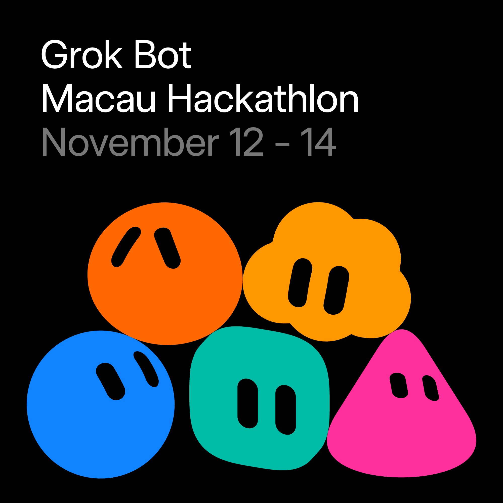
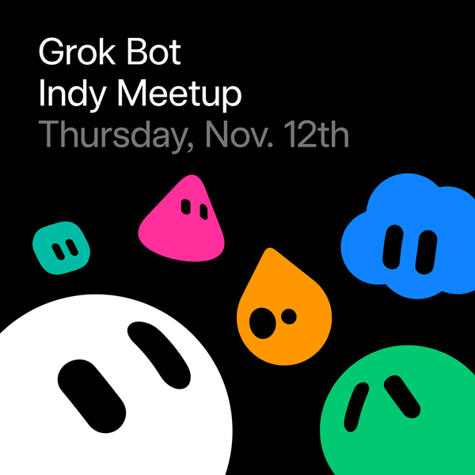
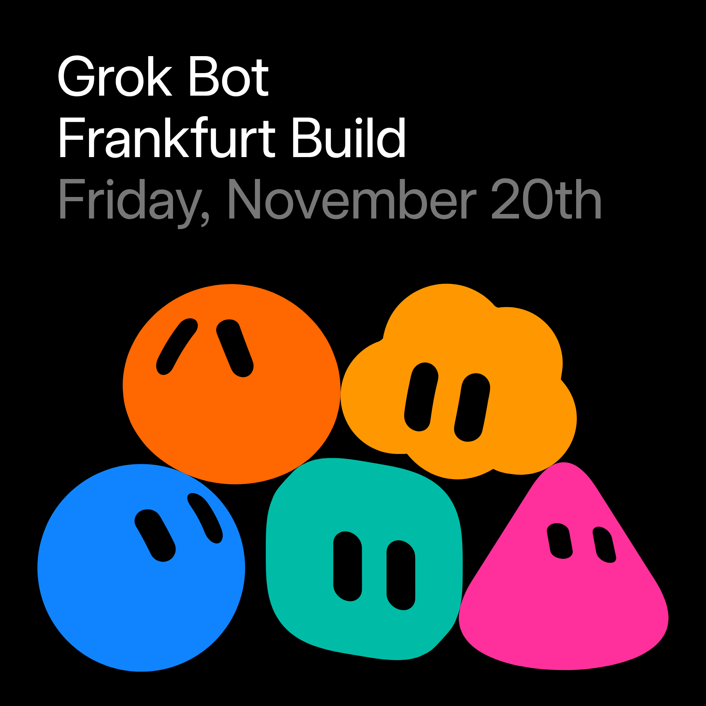
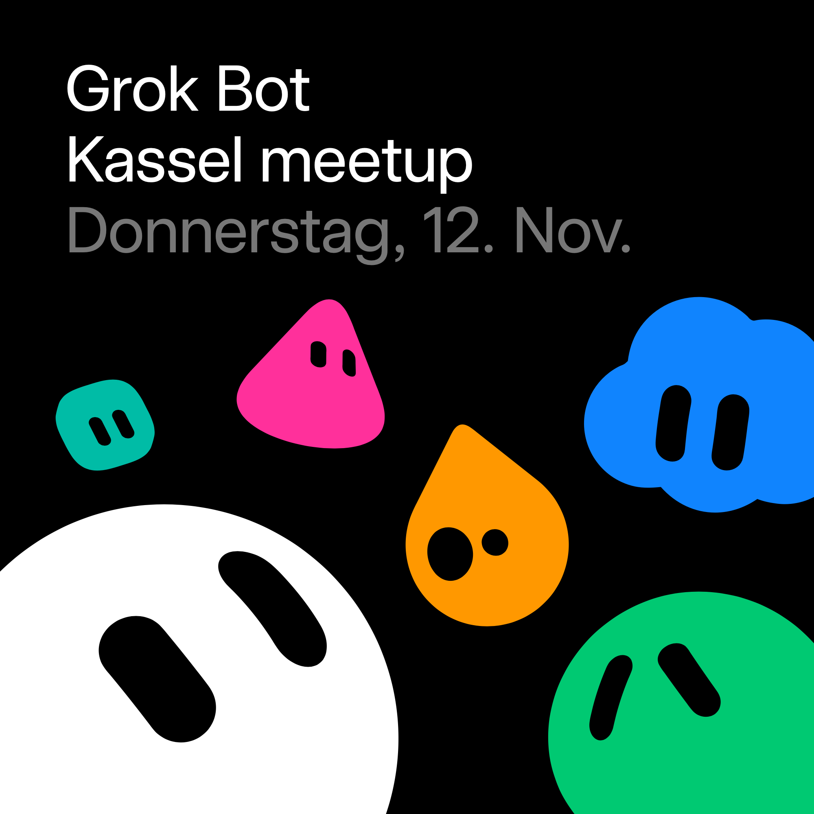
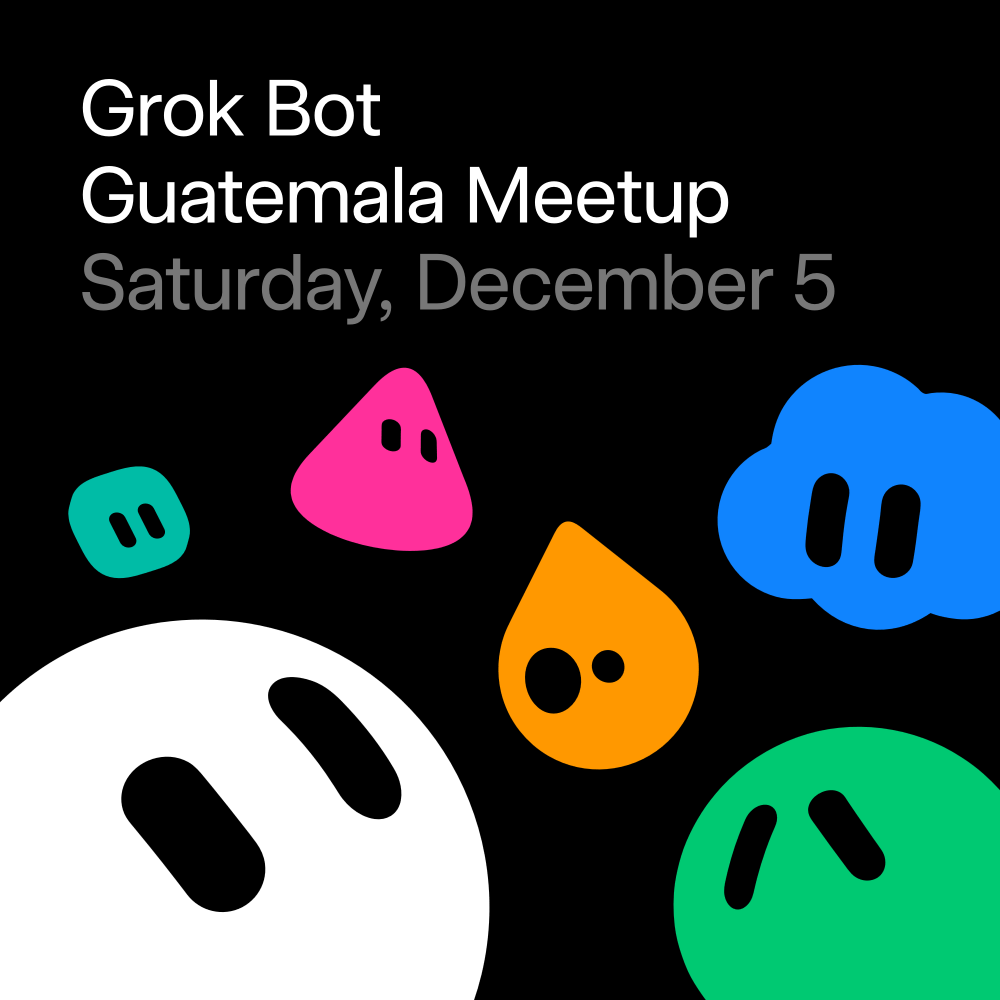
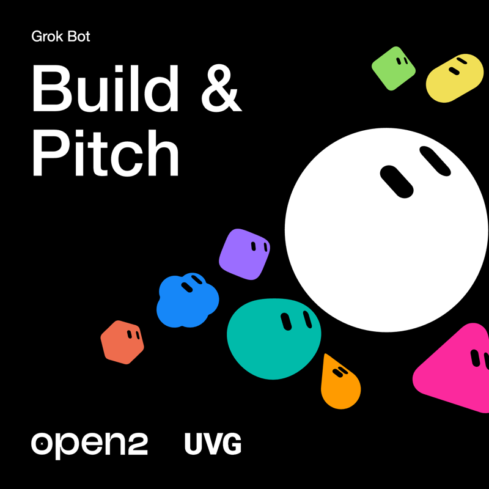
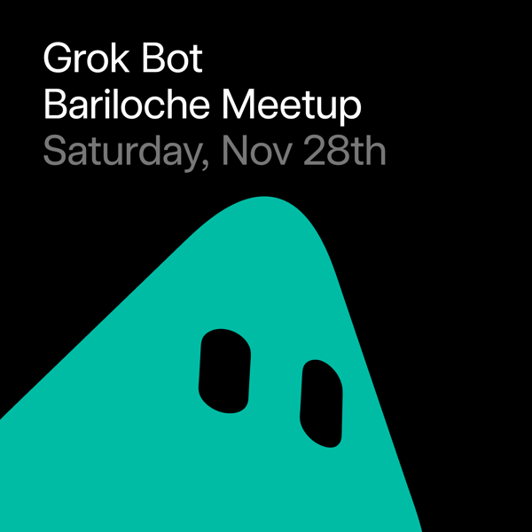
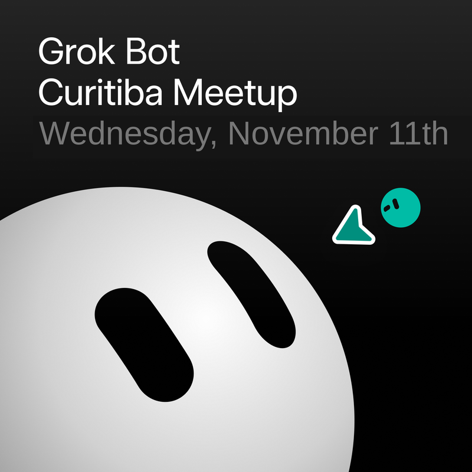

# 活动

<a href="./EVENTS.md"><strong>EN</strong></a> · <strong>中文</strong> · <a href="./EVENTS.ja.md"><strong>日本語</strong></a>

海报、场地和报名方式。首页按国家列出城市，点名称跳到这一页的对应场次。[回 README](README.zh.md)。

[回清单](./README.zh.md)

### 中国

<table><tr><td width="320" valign="top"></td><td valign="top"><strong>SpaceXAI 澳门社区黑客松｜Grok Bot × Physical AI</strong> 2026-11-12 周四 – 11-14 周六，每日 10:00–18:00（Asia/Macau，UTC+8） 澳门 · 澳门旅游塔（Macau Tower）· 线下  澳门三日黑客松，双赛道：用 Grok Bot 三天搭公司，或 Physical AI × Grok Bot（公开+高中生）（主办 John Ku；论坛 173330 / Luma spacexai-macau-hackathlon-nov）。自带电脑；个人报名现场组队；需审批；早间扫描剩余约 80 席。  <a href="https://luma.com/spacexai-macau-hackathlon-nov"><strong>去 Luma 报名 →</strong></a></td></tr></table>

### 美国

<table><tr><td width="320" valign="top"></td><td valign="top"><strong>Cursor Meetup 费城 — 十一月场</strong> 2026-11-17 周二 18:00–20:30（America/New_York） 费城 · SpaceXAI Philadelphia — 线下  SpaceXAI Community 费城十一月 Cursor/Grok 局。Luma 报名。  <a href="https://luma.com/cursor-acqy"><strong>去 Luma 报名 →</strong></a></td></tr></table>

<table><tr><td width="320" valign="top"></td><td valign="top"><strong>Cursor Meetup 费城 — 十二月场</strong> 2026-12-17 周四 18:00–20:30（America/New_York） 费城 · SpaceXAI Philadelphia — 线下  SpaceXAI Community 费城十二月 Cursor/Grok 局。Luma 报名。  <a href="https://luma.com/cursor-8wr8"><strong>去 Luma 报名 →</strong></a></td></tr></table>

<table><tr><td width="320" valign="top"></td><td valign="top"><strong>Grok Bot 坦帕湾 Meetup</strong> 2026-11-14 周六 13:00–16:00（America/New_York） 美国佛罗里达坦帕湾 · 场地待定（报名后通知）。线下。  坦帕湾线下 Grok Bot 聚会（SpaceXAI Tampa）。Luma 报名。  <a href="https://luma.com/spacexai-g0x6"><strong>去 Luma 报名 →</strong></a></td></tr></table>

<table><tr><td width="320" valign="top"></td><td valign="top"><strong>Grok Bot Meetup 印第安纳波利斯</strong> 2026-11-12 周四 18:00–20:00（America/Indiana/Indianapolis，EST，UTC−5） 美国印第安纳州 Fishers（印第安纳波利斯周边）· Launch Fishers（12175 Visionary Way）— 线下  面向印第安纳波利斯开发者和企业主的首场 Grok Bot 聚会：介绍、现场演示、问答，然后动手搭建（带电脑和想法）并由参会者展示，目标是带走一个能干活的 Bot。无需经验。免费；主办 Jacob Thifault；论坛 173949；slug cudopyt3。  <a href="https://luma.com/cudopyt3"><strong>去 Luma 报名 →</strong></a></td></tr></table>

<table><tr><td width="320" valign="top"></td><td valign="top"><strong>Grok Bot 查塔努加线下交流</strong> 2026-12-16 周三 18:00–20:00（America/New_York，EST，UTC−5） 美国田纳西州查塔努加 · The Enterprise Center（1010 Georgia Ave）— 线下  SpaceXAI for Chattanooga 日历上的 Grok Bot 线下交流，主办 Will Rowston；Luma 页面暂无议程。免费报名。  <a href="https://luma.com/xoi05vfx"><strong>去 Luma 报名 →</strong></a></td></tr></table>

### 德国

<table><tr><td width="320" valign="top"></td><td valign="top"><strong>Build with Grokbot — 法兰克福（11月20日）</strong> 2026-11-20 周五 14:00–22:30（Europe/Berlin，UTC+1）。 德国法兰克福 — Hotel Motel One Frankfurt-Messe（线下）。  法兰克福继 9/10 月场次后的下一场 Build with Grokbot（SpaceXAI for Frankfurt；主办 DJ Gangan 等）。Motel One Messe 下午到晚上搭建；候补开放（扫描时 guest_count 3）。slug l9tfh081。  <a href="https://luma.com/l9tfh081"><strong>去 Luma 报名 →</strong></a></td></tr></table>

<table><tr><td width="320" valign="top"></td><td valign="top"><strong>Grok Bot Meetup 卡塞尔</strong> 2026-11-12 周四 18:00–22:00（卡塞尔 CET，UTC+1） 德国卡塞尔 · 报名后可见场地（Bettenhausen 一带）· 线下  卡塞尔首场 Grok Bot 聚会（SpaceXAI for Kassel；主办 Eyad Kelleh、Maurice Pfurr 等；论坛 173331 / Luma rx61bqy9）。闲聊、演示、现场试用额度；需审批+候补；早间扫描 guest_count 2。  <a href="https://luma.com/rx61bqy9"><strong>去 Luma 报名 →</strong></a></td></tr></table>

### 危地马拉

<table><tr><td width="320" valign="top"></td><td valign="top"><strong>Grok Bot Meetup 危地马拉</strong> 2026-12-05 周六 15:00–20:00（America/Guatemala） 危地马拉 · 场地待定（见 Luma/主办方更新）— 线下  SpaceXAI 危地马拉线下 Grok Bot 聚会（论坛+Luma 已发）。场地细节见 Luma 报名页。  <a href="https://luma.com/spacexai-97mt"><strong>去 Luma 报名 →</strong></a></td></tr></table>

<table><tr><td width="320" valign="top"></td><td valign="top"><strong>Grok Bot 危地马拉：Build & Pitch</strong> 2026-11-21 周六 08:00–15:00（America/Guatemala，CST，UTC−6） 危地马拉城 · 危地马拉谷大学（报名后公布具体地址）— 线下  西语 Build & Pitch：连续四小时用 Grok Bot 单人或组队开发，再做简短路演并获得现场反馈。免费报名；论坛 173855；slug c398wllp。  <a href="https://luma.com/c398wllp"><strong>去 Luma 报名 →</strong></a></td></tr></table>

### 阿根廷

<table><tr><td width="320" valign="top"></td><td valign="top"><strong>Grok Bot 巴里洛切线下交流 · 社区一周年</strong> 2026-11-28 周六 19:00–22:00（阿根廷时间，ART，UTC−3） 阿根廷圣卡洛斯-德巴里洛切 · Av. Ezequiel Bustillo 3170 — 线下  SpaceXAI Bariloche 社区一周年 Show & Tell：谁都可以花几分钟展示一个 AI 项目、点子或实验，也可以只来看看；不需要 AI 基础。主办 Alonso Arias。免费。  <a href="https://luma.com/spacexai-ztlq"><strong>去 Luma 报名 →</strong></a></td></tr></table>

### 巴西

<table><tr><td width="320" valign="top"></td><td valign="top"><strong>Grok Bot 库里蒂巴创业线下</strong> 2026-11-11 周三 18:30–21:00（库里蒂巴） 库里蒂巴 Rua Marcos Moro 72  库里蒂巴创业场：用 Grok Bot 做事、创始人经验，以及智能体时代怎么把想法做出来（嘉宾待定）。需主办审核。  <a href="https://luma.com/cursor-dx23"><strong>去 Luma 报名（需审核） →</strong></a></td></tr></table>

### 埃塞俄比亚

<table><tr><td width="320" valign="top"></td><td valign="top"><strong>Grok Bot Hackathon 吉马</strong> 2026-11-14 周六 08:00 至 11-15 周日 11:00（Africa/Addis_Ababa，EAT，UTC+3） 埃塞俄比亚吉马 · 吉马大学 — 线下  SpaceXAI 亚的斯亚贝巴日历发布、在吉马大学举办的通宵 Grok Bot Hackathon，主办 natnael Eskinder 和 Alpha Lencho。免费报名；论坛 173854；slug spacexai-yijh。  <a href="https://luma.com/spacexai-yijh"><strong>去 Luma 报名 →</strong></a></td></tr></table>

### 多哥

<table><tr><td width="320" valign="top"></td><td valign="top"><strong>Grok Bot 构建日 洛美</strong> 2026-11-14 周六 09:00–17:00（Africa/Lome，GMT，UTC+0） 多哥洛美 · Lomé Business School（LBS），96 Jean-Paul 2 — 线下  法语一日 Hackathon：介绍 Grok Bot、组队、用一整天做出你的 bot 或工具，向评委演示并交流，无需经验。免费报名；论坛 173853；slug syepftk0。  <a href="https://luma.com/syepftk0"><strong>去 Luma 报名 →</strong></a></td></tr></table>
