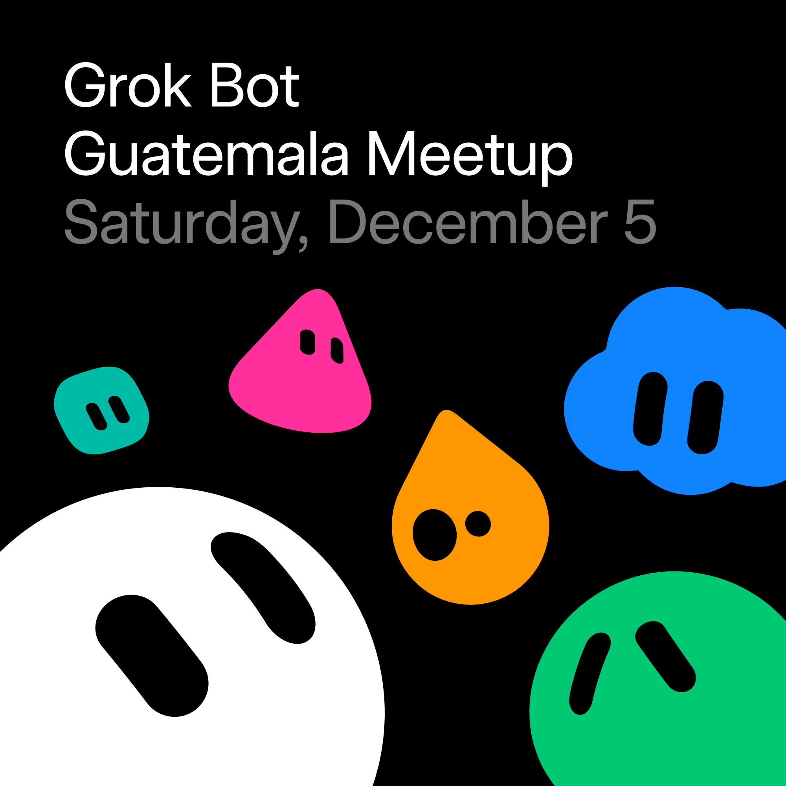
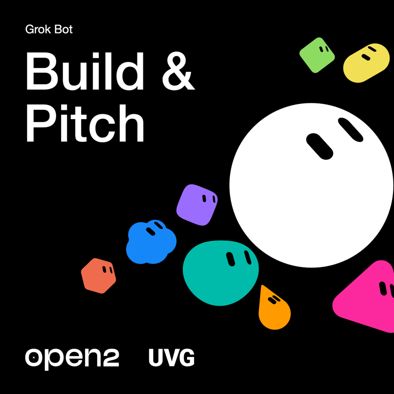
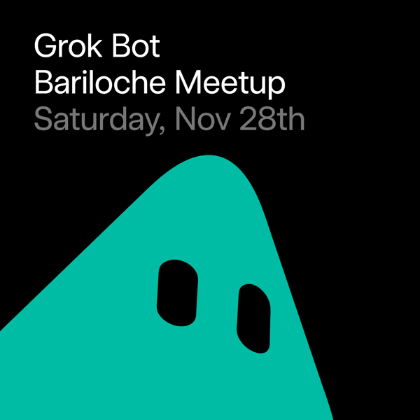
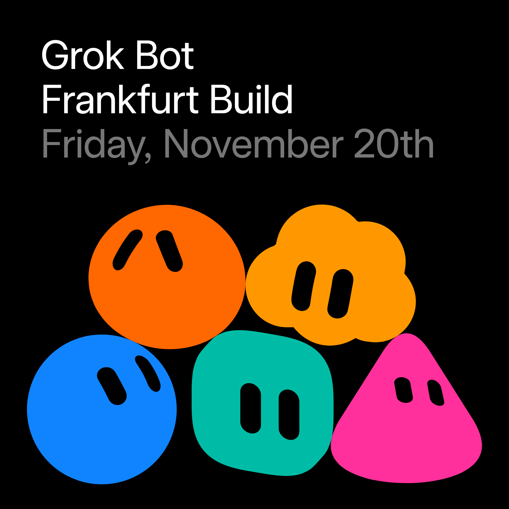

# 活动

<a href="./EVENTS.md"><strong>EN</strong></a> · <strong>中文</strong> · <a href="./EVENTS.ja.md"><strong>日本語</strong></a>

海报、场地和报名方式。首页按国家列出城市，点名称跳到这一页的对应场次。[回 README](README.zh.md)。

[回清单](./README.zh.md)

### 危地马拉

<table><tr><td width="320" valign="top"></td><td valign="top"><strong>Grok Bot Meetup 危地马拉</strong> 2026-12-05 周六 15:00–20:00（America/Guatemala） 危地马拉 · 场地待定（见 Luma/主办方更新）— 线下  SpaceXAI 危地马拉线下 Grok Bot 聚会（论坛+Luma 已发）。场地细节见 Luma 报名页。  <a href="https://luma.com/spacexai-97mt"><strong>去 Luma 报名 →</strong></a></td></tr></table>

<table><tr><td width="320" valign="top"></td><td valign="top"><strong>Grok Bot 危地马拉：Build & Pitch</strong> 2026-11-21 周六 08:00–15:00（America/Guatemala，CST，UTC−6） 危地马拉城 · 危地马拉谷大学（报名后公布具体地址）— 线下  西语 Build & Pitch：连续四小时用 Grok Bot 单人或组队开发，再做简短路演并获得现场反馈。免费报名；论坛 173855；slug c398wllp。  <a href="https://luma.com/c398wllp"><strong>去 Luma 报名 →</strong></a></td></tr></table>

### 美国

<table><tr><td width="320" valign="top"></td><td valign="top"><strong>Cursor Meetup 费城 — 十二月场</strong> 2026-12-17 周四 18:00–20:30（America/New_York） 费城 · SpaceXAI Philadelphia — 线下  SpaceXAI Community 费城十二月 Cursor/Grok 局。Luma 报名。  <a href="https://luma.com/cursor-8wr8"><strong>去 Luma 报名 →</strong></a></td></tr></table>

<table><tr><td width="320" valign="top"></td><td valign="top"><strong>Grok Bot 查塔努加线下交流</strong> 2026-12-16 周三 18:00–20:00（America/New_York，EST，UTC−5） 美国田纳西州查塔努加 · The Enterprise Center（1010 Georgia Ave）— 线下  SpaceXAI for Chattanooga 日历上的 Grok Bot 线下交流，主办 Will Rowston；Luma 页面暂无议程。免费报名。  <a href="https://luma.com/xoi05vfx"><strong>去 Luma 报名 →</strong></a></td></tr></table>

### 阿根廷

<table><tr><td width="320" valign="top"></td><td valign="top"><strong>Grok Bot 巴里洛切线下交流 · 社区一周年</strong> 2026-11-28 周六 19:00–22:00（阿根廷时间，ART，UTC−3） 阿根廷圣卡洛斯-德巴里洛切 · Av. Ezequiel Bustillo 3170 — 线下  SpaceXAI Bariloche 社区一周年 Show & Tell：谁都可以花几分钟展示一个 AI 项目、点子或实验，也可以只来看看；不需要 AI 基础。主办 Alonso Arias。免费。  <a href="https://luma.com/spacexai-ztlq"><strong>去 Luma 报名 →</strong></a></td></tr></table>

### 德国

<table><tr><td width="320" valign="top"></td><td valign="top"><strong>Build with Grokbot — 法兰克福（11月20日）</strong> 2026-11-20 周五 14:00–22:30（Europe/Berlin，UTC+1）。 德国法兰克福 — Hotel Motel One Frankfurt-Messe（线下）。  法兰克福继 9/10 月场次后的下一场 Build with Grokbot（SpaceXAI for Frankfurt；主办 DJ Gangan 等）。Motel One Messe 下午到晚上搭建；候补开放（扫描时 guest_count 3）。slug l9tfh081。  <a href="https://luma.com/l9tfh081"><strong>去 Luma 报名 →</strong></a></td></tr></table>
